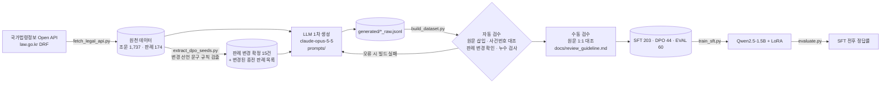

# Korean-Legal-IP-Reasoning-Dataset

국가법령정보 Open API의 **조문·판례 원문**을 근거로, 법률·지식재산(특허법·상표법·민법) 분야의
**SFT / DPO 합성 데이터**를 구축하는 파이프라인과 평가.

- SFT 203문항 · DPO 44쌍 · 평가셋 60문항 (학습 미사용, 판례 변경 문항 포함)
- SFT → DPO 2단계 학습(Qwen2.5-1.5B-Instruct + LoRA)과 3단계(base/SFT/DPO) 비교, 형식 단서를 제거한 DPO v1.1 재실험
- 모든 사건번호·조문번호는 원천 데이터와 자동 대조(존재하지 않으면 빌드 실패)
- SFT: 삼단논법 형식 준수율 **8.3% → 98.3%**, 정답률 51.7% → 58.3%
- **주요 결과 1** SFT 후 모델이 인용 형식에 맞춰 존재하지 않는 판례를 생성: 인용 사건번호 19건 전부 가공
- **주요 결과 2** DPO(44쌍)는 학습 쌍에서 선호 정확도 100%에 도달했지만 평가셋 정답률은 45.0%로 하락: 판례 내용보다 '전원합의체·판례 변경' 같은 형식적 단서에 맞춰져 가공 판례 인용이 19건 → 45건으로 증가 (자세한 내용은 아래 4. 결과, 5. 에러 분석과 한계)
- **주요 결과 3 (v1.1)** chosen/rejected의 인용 형식을 맞추고 단서 문구를 지운 28쌍(검증용 6쌍 별도)으로 같은 설정의 DPO를 다시 학습: 정답률 하락이 사라졌고(같은 세션 SFT 58.3% → 58.3%, v1.0은 45.0%), '전원합의체' 언급 급증(6 → 45건)도 7 → 13건으로 줄었다. 다만 정답률 개선은 없었고 인용 판례는 여전히 전부 가공 (→ 4-4)

---

## 1. Problem Statement

법률 도메인에서 LLM의 오류는 대부분 존재하지 않거나 잘못된 근거를 인용하는 데서 나온다.

| 문제 | 예 | 이 데이터셋의 대응 |
|---|---|---|
| **판례 환각** | 존재하지 않는 사건번호, 틀린 선고일 | 사건번호를 원천 판례와 자동 대조, 인용 표기는 메타데이터로 생성 |
| **조문 문언의 기계적 적용** | 간접침해 조문만 보고 실시권자 공급도 침해로 판단 | **Rule-Precedent Exception** 유형(조문과 판례 해석이 다른 경우) |
| **판례 변경 미반영(Temporal)** | 전원합의체로 변경된 종전 판례를 현재 법리로 답변 | **Precedent Conflict** 유형 + 종전 판례를 rejected로 쓴 DPO |
| **결론만 있는 답변** | 근거 없이 O/X만 출력 | 모든 출력을 **법률 삼단논법 CoT**로 정렬: [대전제: 조문·판례] → [소전제: 사안 포섭] → [결론] |

핵심 설계: **"대전제는 원문에서, 추론은 LLM에서"**
SFT의 조문 인용문은 LLM이 쓰지 않는다. LLM은 인용 *위치*만 출력하고, 파이프라인이 국가법령정보 API 원문을 항·호·목 단위로 삽입한다.

## 2. 데이터 구성

### SFT (`data/legal_sft_dataset.jsonl`, 203문항)

| 유형 | 정의 | 목표 비율 | 실제 | 특허법 | 상표법 | 민법 |
|---|---|:-:|:-:|:-:|:-:|:-:|
| **Standard** | 조문 문언·대표 판례 법리를 묻는 OX/사례형 | 80% | 160 (78.8%) | 72 | 49 | 39 |
| **Rule-Precedent Exception** | 조문 문언과 판례 해석이 다른 경우 | 15% | 31 (15.3%) | 20 | 7 | 4 |
| **Precedent Conflict** | 전원합의체 판례 변경(Temporal Knowledge) | 5% | 12 (5.9%) | 8 | 4 | – |

- 형식: OX 185 / 사례형 QA 18, OX 정답 분포 O 101 : X 84
- 출력 예시 (Precedent Conflict)

```text
[대전제]
상표법 제89조: "상표권자는 지정상품에 관하여 그 등록상표를 사용할 권리를 독점한다. …"   ← API 원문 자동 삽입
대법원 2021. 3. 18. 선고 2018다253444 전원합의체 판결: … 후출원 등록상표에 대한 등록무효 심결의
확정 여부와 상관없이 선출원 등록상표권에 대한 침해가 성립한다.
※ 판례 변경: 위 판결로 종전 대법원 86도277, 98다54434 판결은 변경되었다.                 ← 원문 변경 선언에서 자동 추출
[소전제] 종전에는 후출원 등록상표가 무효로 확정될 때까지는 침해가 되지 않는다고 보았으나 …
[결론] 무효심결 확정 여부와 상관없이 을의 사용은 갑의 선출원 등록상표권 침해에 해당한다.
```

### DPO (`data/legal_dpo_dataset.jsonl`, 44쌍)

| 유형 | chosen | rejected | 쌍 |
|---|---|---|:-:|
| Precedent Conflict | 변경된 판례(전원합의체)를 적용한 답 | **실제 종전 판례 사건번호**를 근거로 한 종전 판례 기준 답변 | 34 (11개 판결) |
| Rule-Precedent Exception | 판례 해석을 반영한 답 | 조문 문언만 기계적으로 적용한 답 | 10 |

판례 변경 사례는 LLM이 고른 것이 아니라, **판결 원문의 변경 선언 문구**("이 판결의 견해에 배치되는 범위에서 이를 변경하기로 한다")로 규칙 기반 확정한 15건 중 11건이다(4건은 평가셋 전용).

핵심 사례: 대법원 2025. 9. 18. 선고 2021두59908 전원합의체 판결

| | 내용 |
|---|---|
| prompt | 국내 미등록 특허기술을 국내에서 사용하고 국외 특허권자에게 사용대가를 지급하는 계약은 유효한가? |
| chosen | 유효하다. 계약자유 원칙상 체결이 가능하고, 속지주의와 양립하며, 강행규정에 반하지 않는다. 종전 판례는 변경되었다. |
| rejected | 속지주의상 국내 사용이나 그 대가 지급을 관념할 수 없어 무효다. (근거: 대법원 2022. 2. 10. 선고 2018두36592 판결: 이 판결로 변경된 종전 판례) |

### 평가셋 (`data/eval_set.jsonl`, 60문항)

| 유형 | 문항 | 근거 |
|---|:-:|---|
| Standard | 40 | 학습에 쓰지 않은 조문(15개 조) 26문항 + 판례 8건 14문항 |
| Rule-Precedent Exception | 10 | 학습에 쓰지 않은 예외 판례 5건 |
| Precedent Conflict | 10 | 학습에 쓰지 않은 판례 변경 4건 (변경 후 법리=O / 종전 관점=X) |

**누수 방지**: 학습셋과 *근거 단위*(판례·조문)로 분리했다. 같은 판례를 다른 문장으로 묻는 것도 누수로 보고 차단했다(`data/build_report.json` → `leak_check`: 중복 0건).

## 3. 파이프라인



| 단계 | 스크립트 | 비고 |
|---|---|---|
| 수집 | `src/fetch_legal_api.py` | 특허법·상표법·민법 현행 조문, 대법원 판례(판결요지·전문), 판례 변경 문구 플래그 |
| 판례 변경 확정 | `src/extract_dpo_seeds.py` | 전원합의체 + 변경 선언 문구 + IP 사건 → 15건, 종전 판례 사건번호 추출 |
| 1차 생성 | `src/generate_sft_dpo.py` | 생성 모델·프롬프트 공개(아래), 생성 계획 `data/generation_plan.json` |
| 검수·조립 | `src/build_dataset.py` | 결과 `data/build_report.json` |
| 학습 | `src/train_sft.py` | LoRA r=16, α=32, lr 2e-4, 3 epochs, fp16, T4 |
| 평가 | `src/evaluate.py` | 탐욕 디코딩, `[결론]`에서 O/X 추출, 유형별·법령별 정답률 |

### 생성 LLM과 프롬프트 (재현성)
- 생성 모델: **`claude-opus-5-5`** (Anthropic)
- 프롬프트: [`prompts/system.md`](prompts/system.md), [`prompts/sft_generation.md`](prompts/sft_generation.md), [`prompts/dpo_generation.md`](prompts/dpo_generation.md), [`prompts/eval_generation.md`](prompts/eval_generation.md)
- v1.0.0 데이터의 1차 생성은 위 모델·프롬프트를 대화형 인터페이스에서 실행했다. 같은 과정을 API로 재현하는 스크립트가 `src/generate_sft_dpo.py`이다(LLM 특성상 문장은 실행마다 달라질 수 있으며, 결과는 동일한 `build_dataset.py` 검수를 거친다).

### 검수 (Human-in-the-Loop)
LLM 1차 생성 데이터를 조문·판례 원문(국가법령정보센터)과 1:1 대조하여 검수. 검수 기준(근거 조문 일치, 판례 최신성, 결론–근거 정합성)은 [docs/review_guideline.md](docs/review_guideline.md)에 명시.

- 자동 검수: 사건번호·조문번호 존재 검증, 판례 변경 문구 확인, DPO rejected의 종전 판례 포함 여부, 평가셋 누수 검사
- 수동 검수: 평가셋의 Precedent Conflict·Rule-Precedent Exception **20문항 전수**를 원문과 대조 → PASS 20 / FIX 0 / DROP 0 (근거 조문 보완 2건). 나머지 287문항은 자동 검수만 수행
- 검수 기록: `data/review/review_sheet_reviewed.csv` (전체 시트: `review_sheet.csv`)
- 이번 버전에서 실제로 고친 사례는 검수 기준 문서 6절에 정리

## 4. 결과 (base → SFT → DPO)

평가셋 60문항(학습 미사용 근거), Qwen2.5-1.5B-Instruct, 탐욕 디코딩. 세 모델 모두 Colab T4 한 세션에서 실행.
- SFT: LoRA r=16, 3 epochs (loss 1.59 → 0.89)
- DPO: SFT 모델을 병합해 레퍼런스(π_ref)로 고정하고 새 LoRA 학습, β=0.1, lr 5e-5, 3 epochs, 44쌍 (손실 직접 구현: `src/train_dpo.py`)

### 4-1. 정답률과 형식

| 구분 | n | Base | +SFT | +SFT+DPO |
|---|---:|---:|---:|---:|
| **전체 정답률** | 60 | 51.7% | **58.3%** | 45.0% |
| 균형 정답률(O·X 정답 문항 평균) | 60 | 48.4% | **56.0%** | 44.4% |
| 정답이 X인 문항 정답 수 | 28 | 0 | 6 | 10 |
| Standard | 40 | 55.0% | **65.0%** | 50.0% |
| Rule-Precedent Exception | 10 | 50.0% | 50.0% | 50.0% |
| Precedent Conflict | 10 | 40.0% | 40.0% | 20.0% |
| **삼단논법 형식 준수율** | 60 | 8.3% | **98.3%** | 88.3% |
| O/X 파싱 실패 | 60 | 2 | 1 | 7 |

- **Base는 대부분 O로 답했다**: 60문항 중 58문항을 O로 답했다("항상 O" 기준선 53.3%와 차이 없음).
- **SFT 효과는 '형식'에서 크고 '판단'에서 작다**: 형식 준수율 98.3%, 예외·판례 변경 유형 정답률은 그대로.
- **DPO 후 평가셋 성능이 하락했다**: O 쏠림은 줄었지만(X 정답 6 → 10) 전체 정답률·형식 준수율이 하락했다.

### 4-2. 인용 실재성 (환각): `results/citation_check.json`

| 구분 | Base | +SFT | +SFT+DPO |
|---|---:|---:|---:|
| 인용 사건번호 중 **가공(존재하지 않음)** | – (인용 없음) | **19 / 19** | **45 / 45** |
| 인용 조문(조·항) 중 **가공** | – (인용 없음) | 45 / 56 | 50 / 59 |
| 응답에 '전원합의체'가 등장한 수 | 0 | 6 / 60 | **45 / 60** |

### 4-3. DPO 학습 동역학: `results/dpo_train_log.json`

| step | DPO loss | 보상 정확도(chosen > rejected) | 보상 마진 |
|---:|---:|---:|---:|
| 1 | 0.693 | 0.00 | 0.00 |
| 6 | 0.233 | 1.00 | 1.42 |
| 16 | 0.003 | 1.00 | 6.41 |
| 33 (끝) | 0.001 | 1.00 | 8.24 |

학습 쌍 선호 정확도 100%(판례 변경·예외 모두), loss ≈ 0 → **44쌍에 과적합**. 보상 마진 8.24는 β=0.1 기준 레퍼런스 대비 log-확률 차이가 약 82에 달할 만큼 정책이 멀리 이동했다는 뜻이다.

### 4-4. DPO v1.1: 형식 단서를 제거한 재실험

v1.0의 원인(chosen에만 '전원합의체', '판례 변경' 문구)을 데이터에서 제거하고, **하이퍼파라미터는 그대로**(β=0.1, lr 5e-5, 3 epochs) 두어 데이터 변경 효과만 비교했다. 같은 Colab 세션에서 SFT를 다시 학습(`sft_run2`)해 기준으로 삼았다. 노트북: `notebooks/colab_dpo_v11.ipynb`

**데이터 변경** (`src/build_dpo_v11.py` → `data/legal_dpo_dataset_v11.jsonl`)
- chosen에서 '전원합의체', 판례 변경 괄호, 종전·변경을 언급하는 문장을 삭제 → chosen/rejected 모두 "대법원 … 선고 … 판결: 요지" 형식. 차이는 적용한 판례와 결론에만 남김
- 변환 후 단서 문구(`전원합의체|종전|변경|현재 판례|이전의`)가 남으면 빌드 실패
- 예외 유형 10쌍은 제외: chosen만 판례를 인용하는 구조라 형식을 맞출 수 없음
- 시드 판례 2건(6쌍)을 **학습에 쓰지 않는 검증용 쌍**으로 분리 → 학습 28쌍
- 남은 차이: 평균 길이 chosen 239자 / rejected 167자

| 구분 | SFT (v1.0 세션) | DPO v1.0 | SFT (v1.1 세션) | DPO v1.1 |
|---|---:|---:|---:|---:|
| 전체 정답률 | 58.3% | 45.0% | 58.3% | **58.3%** |
| 균형 정답률 | 56.0% | 44.4% | 56.5% | 56.2% |
| Precedent Conflict (10문항) | 40% | 20% | 40% | 50% |
| 형식 준수율 | 98.3% | 88.3% | 98.3% | 96.7% |
| '전원합의체' 언급 응답 | 6 | **45** | 7 | 13 |
| 인용 사건번호(전부 가공) | 19 | **45** | 17 | 14 |
| 학습 쌍 선호 정확도 | – | 100% | – | 100% |
| **검증용 쌍 선호 정확도** | – | (측정 안 함) | – | **83.3% (5/6)** |

**해석**
- 형식 단서를 지우자 v1.0의 부작용(정답률 하락, 가공 '전원합의체' 판결 남발)이 사라졌다. v1.0의 하락이 데이터 설계 때문이었다는 해석과 맞는다.
- 학습에 쓰지 않은 판례의 쌍도 5/6을 맞혀, 선호 자체는 어느 정도 일반화되었다(1 epoch 후부터 83.3%로 유지).
- 그러나 평가셋 정답률은 그대로다. SFT 대비 7문항이 맞게, 7문항이 틀리게 바뀌어 순변화 0이고, SFT를 같은 설정으로 다시 학습하는 것만으로도 4문항이 바뀐다. 판례 변경 유형 +1문항(40 → 50%)은 이 변동 범위 안이다.
- 인용 판례는 여전히 전부 가공이다. 선호 학습으로 "어느 판례를 따를지"는 조정할 수 있어도, 모델이 모르는 판례를 정확히 인용하게 만들지는 못한다 → 추론 시 원문 검색(RAG)이 필요하다는 5-2의 결론을 유지한다.
- 학습 loss는 여전히 0.003까지 내려가 28쌍을 외웠다. 검증 정확도가 1 epoch 이후 변하지 않았으므로 1 epoch로 충분했다.

## 5. 에러 분석과 한계

### 5-1. SFT 모델의 오류 패턴 ([docs/error_analysis.md](docs/error_analysis.md))

**① 지문 복제형 대전제 (60문항 중 28건)**: 모델이 지문을 거의 그대로 베껴 가짜 조문·판례로 포장한 뒤, "지문은 판례와 일치한다"로 결론을 낸다. 이 28건 중 26건이 O로 답했고, **O 쏠림의 주원인**이다.

```text
지문: 당사자의 궁박, 경솔 또는 무경험으로 인하여 현저하게 공정을 잃은 법률행위는 취소할 수 있다.   (정답 X: 민법 제104조는 '무효')
SFT : [대전제] 민법 제109조 제2항: "② 당사자가 궁박, 경솔 또는 무경험 … 법률행위는 취소할 수 있다."  ← 지문을 조문으로 위장
      [결론] O. 지문은 옳다.          (실제 민법 제109조 제2항은 착오 취소의 제3자 효력 규정)
```

**② 가공 판례 인용**: "대법원 2025. 4. 29. 선고 2024다276830 전원합의체 판결"처럼 형식이 완벽한 가짜 판례를 만든다(19건 전부). 학습 데이터의 *인용 형식*은 배웠지만, 평가셋 판례는 학습에 없으므로 내용은 지어낸다.

**③ 조문 번호 고착**: 조문 인용 56건 중 36건이 "특허법/상표법 제103조 제2항"이었다(60개 응답 중 37개). 쟁점과 무관하게 같은 번호를 쓰는 것은, 모델이 조문 번호를 지식이 아니라 형식 토큰으로 학습했음을 보여준다.

**④ DPO의 형식적 단서 학습**: 판례 변경 34쌍의 chosen 답변은 모두 "대법원 … 전원합의체 판결 … (종전 판례 변경)" 구조다. DPO 모델은 이 *형식*을 학습해 60문항 중 45문항에서 '전원합의체'를 언급했고(SFT 6문항), 그 판례는 전부 가공이었다. 판례 변경 문항 정답률은 40% → 20%로 떨어졌다. 모델이 판례의 내용보다 '전원합의체' 인용 여부로 선호를 구별한 것으로 보인다. 같은 문항의 SFT·DPO 실제 출력 비교는 [docs/error_analysis.md 6-1](docs/error_analysis.md#6-1-같은-문항의-sftdpo-출력-비교) 참고.

### 5-2. 결론과 다음 단계

학습 데이터의 대전제를 원문으로 구성하는 것만으로는 부족했다. 추론 시점에도 대전제를 원문에서 가져오는 방식이 필요하다.

| 문제 | 다음 단계 |
|---|---|
| 형식은 배우고 근거는 지어냄 | **검색 증강(RAG)**: 추론 시 국가법령정보 API에서 조문·판결요지를 검색해 [대전제]에 주입 (데이터 설계와 같은 원칙) |
| 가공 판례를 자신 있게 인용 | **DPO 확장**: 가공 인용 응답(이번 SFT 출력)을 rejected, 실재 인용 응답을 chosen으로 하는 쌍 추가 |
| 정답률만으로 환각을 못 봄 | **인용 실재성·근거 일치율**을 1차 지표로 사용 (`evaluate.py --citations`) |
| DPO 과적합·형식적 단서 학습 | **v1.1에서 적용**: 쌍 재설계(같은 인용 형식) + 검증용 쌍 모니터링 → 부작용은 사라졌으나 개선 없음(4-4). 남은 과제: 길이 차이 보정, epoch 축소(1 epoch), 효용이 같은 쌍(tie)을 섞는 정규화 |
| 예외·판례 변경 유형 개선 없음 | 1.5B·소규모 데이터의 한계. 원문 검색 증강(RAG)과 결합, 더 큰 모델에서 재평가 |

### 5-3. 데이터 구축·평가 과정에서 발견한 오류
| 발견 | 원인 | 조치 |
|---|---|---|
| 판례 변경 판정이 전원합의체 18건 중 3건만 검출 | "이 판결의 견해에 배치되는 범위" 표현 누락 | 정규식 보정 → 15건, 원문 문구 함께 출력해 확인 |
| 원심 파기 사건이 판례 변경으로 오탐 | "더 이상 유지될 수 없다"만으로 판정 | "종전 판례/법리 …"로 한정 |
| 2021두59908의 종전 판례 누락 | 앞 문장만 보고 추출 | 마지막 변경 선언 문장 기준 재추출(8건) |
| 2015후1454: 전원합의체지만 변경 문구 없음 | 판례 변경이 아닌 새 법리 선언 | DPO 제외, 예외 문항 근거로만 사용 |
| DPO rejected에 "(종전 판례)" 문구 | 내용이 아닌 문구로 구별 가능 | 문구 제거 |
| **Base 정답률이 26.7%로 과소 측정** | Base가 `[결론] - O`처럼 대시를 붙여 답했는데 파서가 인식 못 해 29문항을 오답 처리 | 파서 수정 후 저장된 출력으로 재채점(`--rescore`) → 51.7%. 개선 폭을 부풀리지 않도록 수정 전 수치는 사용하지 않음 |

### 5-4. 한계
- **규모**: SFT 203문항, 1.5B 모델. 법률 지식 주입이 아니라 형식·태도 정렬 실험이며, 그 효과와 부작용(환각)을 함께 보고한다.
- **평가셋 크기**: 유형별 10문항이라 예외·판례 변경 유형의 정답률은 1문항이 10%p에 해당한다(통계적 결론에 한계).
- **인용 검사 범위**: 조문은 조·항의 *존재 여부*만 검사하며, 실재 조문을 인용하면서 내용을 틀리게 쓴 경우는 잡지 못한다.
- **판례 변경 범위**: 원문 문구로 확정한 IP 분야 15건. 법 개정으로 판례가 의미를 잃은 경우(예: 2012다11310 → 현행 특허법 제99조의2)는 예외 유형으로 일부만 포함.
- **민법 비중**: 수집 판례 중 민법 판례는 IP와 관련이 적은 최신 사건이 많아 조문 중심으로 구성.
- **DPO 규모**: v1.0 44쌍, v1.1 28쌍(검증 6쌍), 하이퍼파라미터 β=0.1 하나, 각 1회 실험. 같은 설정의 SFT 재학습만으로 4문항이 바뀌므로, 1~2문항 차이는 결론으로 삼지 않는다.

## 6. 재현 방법

```bash
pip install -r requirements.txt
export LAW_OC=...                       # open.law.go.kr에서 발급한 OC
python src/fetch_legal_api.py --max-prec 300     # data/raw/ 수집
python src/extract_dpo_seeds.py                  # 판례 변경 확정
python src/build_dataset.py                      # 검수·조립 → data/*.jsonl, build_report.json
python src/evaluate.py --name base               # GPU 필요 (Colab: notebooks/colab_train_eval.ipynb)
python src/train_sft.py --epochs 3
python src/evaluate.py --name sft --adapter outputs/qwen2.5-1.5b-legal-lora
python src/train_dpo.py --sft_adapter outputs/qwen2.5-1.5b-legal-lora
python src/evaluate.py --name dpo --merge_adapter outputs/qwen2.5-1.5b-legal-lora --adapter outputs/qwen2.5-1.5b-legal-dpo-lora
python src/evaluate.py --report base sft dpo
python src/evaluate.py --citations base sft dpo  # 인용 실재성(환각) 검사
# v1.1 재실험 (Colab: notebooks/colab_dpo_v11.ipynb)
python src/build_dpo_v11.py
python src/train_dpo.py --data data/legal_dpo_dataset_v11.jsonl --out outputs/qwen2.5-1.5b-legal-dpo-v11-lora --log results/dpo_v11_train_log.json
```

## 7. 저작권

- 수집 원문은 **저작권법 제7조(보호받지 못하는 저작물)** 에 해당하여 원문을 포함해 공개한다.
  - 조문(특허법·상표법·민법): 제1호 "헌법·법률·조약·명령·조례 및 규칙"
  - 대법원 판결·결정: 제3호 "법원의 판결·결정·명령 및 심판이나 행정심판절차 그 밖에 이와 유사한 절차에 의한 의결·결정 등"
- 교재·문제집 등 저작권 보호 대상 텍스트는 포함하지 않았으며, 모든 문항은 조문·판결 원문에 근거한다.
- 코드: MIT License · 가공 데이터(문항·DPO 쌍): CC BY 4.0

## 8. 디렉터리

```
├── README.md
├── src/
│   ├── fetch_legal_api.py      # 특허법·상표법·민법 조문/판례 수집 (국가법령정보 Open API)
│   ├── extract_dpo_seeds.py    # 판례 변경 전원합의체 판결 확정 + 종전 판례 추출
│   ├── generate_sft_dpo.py     # LLM으로 SFT/DPO/평가 문항 1차 생성 (재현용)
│   ├── build_dataset.py        # 원문 삽입·사건번호 대조·누수 검사 → 최종 데이터셋
│   ├── prompting.py            # 학습·평가 공통 시스템 프롬프트, O/X 파서
│   ├── train_sft.py            # Qwen2.5-1.5B LoRA SFT
│   ├── train_dpo.py            # SFT 모델 위 LoRA DPO (손실 직접 구현, 검증용 쌍 선호 정확도)
│   ├── build_dpo_v11.py        # v1.1: 형식 단서를 제거한 선호 쌍 생성·검사
│   └── evaluate.py             # SFT 전후 정답률 비교
├── prompts/                    # 생성 프롬프트 (system / sft / dpo / eval)
├── data/
│   ├── raw/                    # 원천: statutes.jsonl, precedents.jsonl, dpo_seeds.jsonl
│   ├── generated/              # LLM 1차 생성 결과 (*_raw.jsonl)
│   ├── legal_sft_dataset.jsonl # 법률 삼단논법 CoT: [대전제: 조문]→[소전제: 사안]→[결론]
│   ├── legal_dpo_dataset.jsonl # 판례 변경 반영 chosen / 종전 판례 rejected
│   ├── legal_dpo_dataset_v11.jsonl # v1.1: 같은 인용 형식, train/val 분리
│   ├── eval_set.jsonl          # 학습에 쓰지 않은 60문항 (판례 변경 문항 포함)
│   ├── case_seeds.json         # 수집 대상 판례 후보
│   ├── generation_plan.json    # 생성 계획(원천-유형-문항 수)
│   ├── build_report.json       # 자동 검수 결과
│   └── review/                 # 검수 시트(전체) / 검수 기록(review_sheet_reviewed.csv)
├── docs/review_guideline.md    # 검수 기준
├── docs/error_analysis.md      # SFT 모델 오류 분석
├── notebooks/colab_train_eval.ipynb   # v1.0 전체 실행
├── notebooks/colab_dpo_v11.ipynb      # v1.1 재실험
└── results/                    # 평가 결과: metrics_*, predictions_*, citation_check.json, train_log.json
```
